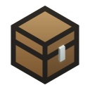

<p align="center">
  
</p>

<h1 align="center">Chest</h1>

<p align="center">
  Your Minecraft worlds, in one place.<br>
  A small Java Edition launcher with a pixel art interface.
</p>

<p align="center">
  <a href="#features">Features</a> &nbsp;·&nbsp;
  <a href="#run-locally">Run locally</a> &nbsp;·&nbsp;
  <a href="#documentation">Documentation</a> &nbsp;·&nbsp;
  <a href="https://github.com/gardengim/chest/releases">Releases</a>
</p>

<p align="center"><sub>Rust core · Tauri 2 · Svelte 5 · MIT licensed</sub></p>

---


<p align="center"><sub>Current interface previews use sample instances and public Modrinth listings. No personal library or account data is shown.</sub></p>

> **0.1.0 · Pre-release**
>
> Chest is being prepared for its first release. Platform testing, installer verification, and distribution acceptance are tracked in the [release checklist](docs/ACCEPTANCE.md).

## Features

**A library that feels like yours.** Keep separate instances for survival, creative builds, modded play, and trying something new. Choose a gallery or a list, organize sidebar groups, and arrange Home shelves around what you use.

| | What Chest brings together |
| :--- | :--- |
| **Instances** | Vanilla, Fabric, Quilt, Forge, and supported NeoForge versions. Create from scratch, choose a modpack, or import a Chest archive. |
| **Content** | Discover projects on Modrinth and CurseForge. Add, enable, disable, and remove local mods, resource packs, and shader packs. |
| **Worlds & servers** | Search across your instances, back up worlds, copy them safely, and keep server bookmarks with a preferred instance. |
| **Screenshots** | Browse your captures, preview the originals, and open their files. Instance artwork can blend provider images with local screenshots. |
| **Launch controls** | Automatic Java selection, per-instance memory and accounts, pause/resume/retry for installation, playtime, and searchable logs. |
| **Appearance** | Light, Dark, or System mode. Import and share themes. Use reduced motion and choose how double-click behaves. |
| **Accessibility** | Keyboard navigation, a skip link, screen-reader announcements, and persistent notifications that stay available across pages. |

Chest speaks **English, 한국어, Español, 日本語, 简体中文, 繁體中文, and العربية**, including right-to-left layout for Arabic.

<details>
<summary><strong>A look at Explore</strong></summary>

<br>


Browse mods, resource packs, shader packs, and modpacks. Filter for a Minecraft version and loader, read project descriptions, and choose compatible releases.

Modrinth works without an API key. CurseForge requires a key issued for Chest; see [catalog setup](#catalog-setup).

</details>

## Run locally

Install **Node.js 22+**, **stable Rust**, and your platform's [Tauri prerequisites](https://v2.tauri.app/start/prerequisites/).

```sh
git clone https://github.com/gardengim/chest.git
cd chest
npm ci
npm run tauri dev
```

| Build target | Platform requirements |
| :--- | :--- |
| **macOS · Apple Silicon / Intel** | macOS 14 or later; Xcode Command Line Tools. |
| **Windows · x64** | Rust's MSVC toolchain, C++ build tools, and WebView2. [Windows guide →](docs/WINDOWS.md) |
| **Linux · x64** | GTK 3, WebKitGTK 4.1, and the desktop build dependencies. A working Secret Service store is needed for account credentials. |

These are build targets and prerequisites; packaged-device acceptance is recorded separately in the [release checklist](docs/ACCEPTANCE.md).

Prefer Bun? Use `bun install --frozen-lockfile` and `bun run tauri dev`. Node.js is still required by the tooling. CI uses `npm ci`; keep both lockfiles in sync when changing dependencies.

For a **browser-only preview**, run `npm run dev`. It uses local example data and can save preview settings; authentication, downloads, and Minecraft launches require the desktop app.

### Accounts & game versions

Sign in through **Settings → Accounts** with a Microsoft account that owns Minecraft Java Edition. Chest includes its own public Microsoft application ID. Refresh tokens are stored in the operating system's credential store.

For supported Minecraft and loader versions, see the [product baseline](docs/BASELINE.md) and [loader guide](docs/LOADERS.md). Bedrock Edition is outside the current scope. Active resource packs, shader-pack selection, and data-pack activation remain Minecraft settings.

Maintaining your own application registration? See [Microsoft setup](docs/MICROSOFT-REGISTRATION.md). Advanced controls appear after enabling **Develop settings** in Settings.

### Catalog setup

To enable CurseForge, start Chest with `CHEST_CURSEFORGE_API_KEY` set to a key issued for the application. The key stays in native requests and is excluded from instance archives. Without it, Explore offers Modrinth and explains the CurseForge setup requirement.

### Build & verify

```sh
npx playwright install chromium
npm run verify
```

This checks release configuration, translations and scripts, frontend compilation, dependency notices, Rust tests and lint, and production-browser behavior.

For installers, signing, and app updates, follow the [release guide](docs/releases.md). For a local verification build and cross-platform evidence, follow the [candidate verification procedure](docs/audit-sop.md). Run build and browser workflows sequentially; they share generated output.

## Your files

Instances and shared downloads are managed locally. You can choose an instance location, open its folder, and use Chest archives or world ZIP backups to keep a copy elsewhere.

Chest asks before destructive actions. Closing the launcher stops its installation work without deliberately terminating running games; this version does not reattach to those games after a restart. Save and close Minecraft normally when possible.

App updates require an explicit installation and restart. Their artifacts are verified against Chest's updater signing key. See [recovery](docs/RECOVERY.md) and [security](docs/SECURITY.md) for the behavior and its limits.

## Documentation

| Start here | Go deeper |
| :--- | :--- |
| [Product scope & supported targets](docs/BASELINE.md) | [Loader installation](docs/LOADERS.md) |
| [Worlds, servers & backups](docs/WORLDS-AND-SERVERS.md) | [Settings & saved changes](docs/SETTINGS.md) |
| [Themes & palette format](docs/COLOR-SCHEMES.md) | [Languages & interface copy](docs/LOCALIZATION.md) |
| [Recovery & security](docs/RECOVERY.md) | [Isolated test profiles](docs/TEST-PROFILES.md) |
| [Release setup](docs/releases.md) | [Verification & acceptance](docs/audit-sop.md) · [Checklist](docs/ACCEPTANCE.md) |
| [Performance workloads](docs/PERFORMANCE.md) | [Card components](docs/CARD-COMPONENTS.md) · [Icon workflow](docs/design/ICON-WORKFLOW.md) |

## License & credits

Chest is [MIT licensed](LICENSE). **Settings → About** includes bundled third-party license notices. When changing dependencies, regenerate notices with `npm run licenses` and verify them with `npm run check:licenses`.

Minecraft belongs to Mojang and Microsoft. Chest is an independent project and is not affiliated with either company. The bundled Minecraft icon retains its [source and attribution](public/minecraft-icon-source.txt).
