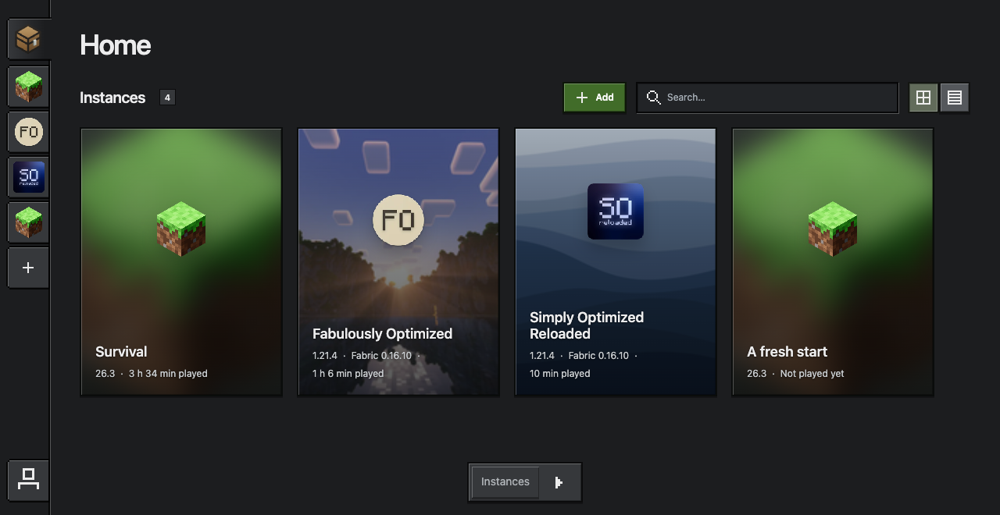
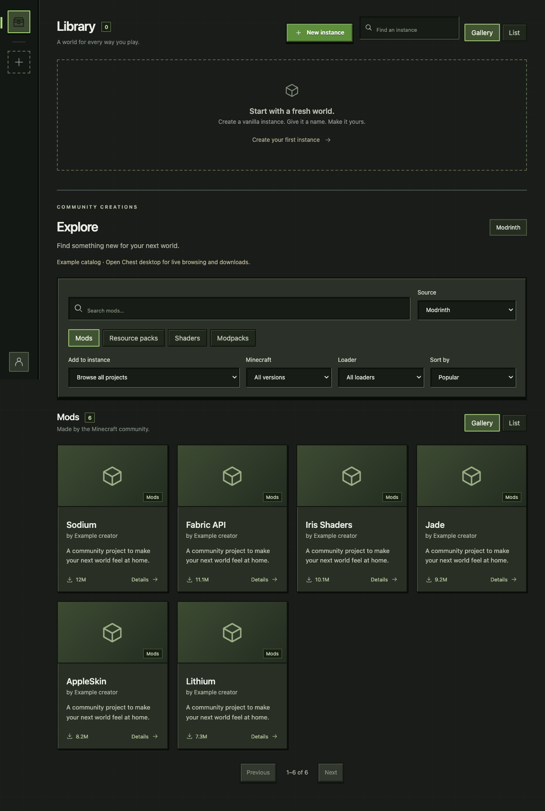

# Chest

**Pre-release:** platform, real authentication/gameplay, and update acceptance are still in progress. See [validation](VALIDATION.md).



A small Minecraft Java Edition launcher. Rust core, Tauri 2 desktop shell, Svelte 5 UI. One app, local files, no backend server.

## Run

Install Node.js 22+, stable Rust, and your platform's [Tauri prerequisites](https://v2.tauri.app/start/prerequisites/).

```sh
npm ci
npm run tauri dev
```

Bun is also supported for local development (Node.js remains required by the tooling):

```sh
bun install --frozen-lockfile
bun run tauri dev
bun run verify
```

CI and release builds use `npm ci` as the canonical dependency installation. Keep
`bun.lock` in sync with `package.json`; either runner can execute the same scripts.

For signed installer builds, follow [release setup](docs/releases.md). Windows needs the MSVC toolchain and WebView2. macOS needs Xcode Command Line Tools. Linux needs GTK 3, WebKitGTK 4.1, and a working Secret Service credential store.

For the browser UI only, run `npm run dev`. This mode saves example instance settings in localStorage and explicitly refuses download, authentication, and launch operations.

## Current scope

Chest manages local Minecraft Java instances, content, accounts, and launches. The
[product baseline](docs/BASELINE.md) defines supported targets and the interaction rules;
[PLAN.md](PLAN.md) tracks the release milestones in dependency order.

- Vanilla release versions from 1.19 onward, including yearly version names, plus
  Fabric, Quilt and Forge. NeoForge supports stable 1.20.2–1.21.x releases.
  Legacy Forge, NeoForge year-based versions, snapshots and Bedrock are outside this baseline.
  See [loader installation and validation](docs/LOADERS.md).
- One-page creation with Custom, Modpacks, and Import sources; optional names, locations,
  local content, and compatible catalog content. Explore pack selection opens creation.
  Explicit Create queues installation; selecting a pack does not install it.
- Customizable Home shelves with horizontal instance/world/server galleries. Drag dock
  icons to reorder shelves; expand More to open hidden tools or drag them onto Home.
  Shelf visibility and order persist locally. News and Explore retain their existing UI.
- Library and Explore gallery/list views, flat sidebar groups, shared instance action
  menus on sidebar tabs and cards, and instance Overview, Content, Versions, Settings,
  and Log tabs. Switching sidebar destinations resets the instance tab to Overview.
- Modrinth and CurseForge discovery, verified content/dependency downloads, mod file
  enable/disable, supported modpack installation, and Chest archive import/export.
  Required client pack files are included; optional and server-only files are skipped.
- Matching automatic Java, executable overrides and checking, memory defaults, default
  instance location, multiple Microsoft accounts, and OS credential-store refresh tokens.
- Background installation with pause/resume/retry, independent running instances, logs,
  playtime, and activity indicators. Stop and deletion require confirmation.
- Global world search, ZIP backups and safe copies between instances; server bookmarks
  with preferred instances and version/loader warnings. [Details](docs/WORLDS-AND-SERVERS.md).
- Dark theme, English/Korean/Spanish/Japanese, reduced motion, configurable double-click launch and startup
  update checks. News includes official Minecraft articles and installed-pack/loader updates.
- Signed app updates from GitHub with explicit installation and restart controls.

Implementation and automated coverage do not establish packaged-app or gameplay
acceptance. See [VALIDATION.md](VALIDATION.md) for the current evidence and remaining gates.

## Home and icons

The sidebar contains Home, instance tabs/groups, Create, and Settings. Home's bottom
dock provides Instances, News, Explore, Worlds, and Servers, even when a section is
hidden from Home. Expand **More** to see hidden tools; clicking one opens its full page.
Drag a tool into or out of the visible group to add/remove a shelf. Drag within the
visible group to reorder Home. Keyboard equivalents: **Alt+Left/Right** to reorder,
**Alt+Down** to hide, and **Alt+Up** to add a hidden tool. **Escape** cancels a drag or
collapses More. Hover/focus hints appear above the dock. All motion respects the
system and launcher reduced-motion preferences.

Symbolic icons keep their original smooth SVG assets in `src/icons/` (indexed by `src/symbols.ts`). The
shared renderer converts each symbol to a cached 24×24 pixel grid when first used,
then draws hard-edged geometry with neutral contrast ink independent of theme text colors. It does not allocate a
canvas or color observer per icon. Chest artwork, Minecraft blocks, project logos,
instance artwork, and screenshots retain their original rendering. Prototypes A/B
remain under `prototypes/` for reference and are excluded from release bundles.

## Color schemes

Open **Settings → Settings → Appearance** to import a JSON or CSS palette, preview it,
apply/export it, or restore Chest's default scheme. Preview is temporary until applied;
Cancel, Escape or leaving the panel restores the saved scheme. Desktop uses native
Open/Save dialogs. Pixel bevels, black structural frames, icon geometry and artwork
remain protected. Background customization is separate and not yet implemented.
See [the color scheme format and palette roles](docs/COLOR-SCHEMES.md).

## Catalog setup

Modrinth browsing and downloads work without an API key. CurseForge requires a key issued for Chest: set `CHEST_CURSEFORGE_API_KEY` in the environment before starting the desktop app. The key stays in Rust requests and is not sent to the frontend or written into instance archives. Without a key, Explore shows a setup-required state and offers Modrinth.

Provider references: [Modrinth API](https://docs.modrinth.com/api/), [CurseForge API and key application](https://docs.curseforge.com/rest-api/).



## Microsoft setup

See the [registration and Minecraft API approval guide](docs/MICROSOFT-REGISTRATION.md) for the exact settings and review form.

Chest has no bundled Microsoft application ID. Register Chest as a public desktop client supporting **personal Microsoft accounts**. Configure the loopback redirect `http://localhost/callback`; Chest supplies an ephemeral local port. Use authorization code + PKCE and no client secret. Requested scopes: `XboxLive.signin offline_access`.

Enter the application's client ID in Settings → Settings → Microsoft application setup, then save defaults. `CHEST_CLIENT_ID` can supply the initial ID when creating a fresh configuration.

Microsoft/Xbox/Minecraft must authorize the application to use the relevant services. A valid UUID by itself does not establish service access. Errors are surfaced without borrowing another launcher's identity. An owning account is required to play. Real sign-in and launch need to be tested with Chest's registration; they are not claimed as verified in this package.

References: [desktop authorization and PKCE](https://learn.microsoft.com/en-us/entra/identity-platform/v2-oauth2-auth-code-flow), [Xbox token exchange](https://learn.microsoft.com/en-us/gaming/gdk/docs/services/fundamentals/s2s-auth-calls/service-authentication/live-website-authentication), [Adoptium API](https://api.adoptium.net/q/swagger-ui/).

## Data and behavior

Rust owns instance/account metadata and game files under Tauri's platform application-data directory for `app.chest.launcher`:

```text
config.json                 instance and account metadata, defaults
instances/<uuid>/game/      worlds, resourcepacks, mods, screenshots
instances/<uuid>/natives/   legacy extracted native libraries
instances/<uuid>/launch.json  merged Fabric/Quilt launch metadata (after installation)
instances/<uuid>/launcher.log
versions/ libraries/ assets/ logging/ java/   shared verified cache
```

Language, motion, double-click launch, startup update checks, and default instance location are local UI preferences stored in the desktop WebView. Memory and Java defaults are stored in `config.json` and apply to new instances. An explicit creation location overrides the default; existing instances stay in their current folders.

The Stop action terminates the game after a confirmation. Prefer saving and closing Minecraft normally. Closing Chest stops installation work and its monitoring; running games are not deliberately killed. This version does not reattach to games after Chest restarts. Persisted process supervision and window focusing are later tasks.

Rust owns game operations and filesystem changes. Svelte owns page state and local UI preferences; there is no hosted Chest backend, background service, or runtime web server. Rust spawns Java directly with separate arguments.

## App icon

The canonical app icon is `public/chest.svg`. The sidebar, loading screen, and browser favicon use it directly. Run `npm run icons` to regenerate desktop assets with Tauri’s icon command. The script also derives `docs/design/chest-macos.svg`, placing the same mark on an almost-white squircle with a soft drop shadow for the macOS ICNS and PNGs. `src-tauri/tauri.macos.conf.json` selects those PNGs on macOS; other platforms keep the transparent mark. Geometry guides belong only to `docs/design/chest-icon-preview.html`.

## Checks

Run `npm run verify` for the same fail-fast checks used by CI (install Playwright Chromium first).

```sh
npm run check
npm run build
cargo test --manifest-path core/Cargo.toml
cargo clippy --manifest-path core/Cargo.toml --all-targets -- -D warnings
cargo check --manifest-path src-tauri/Cargo.toml
# Optional live Fabric metadata/download smoke check:
cargo run --manifest-path core/Cargo.toml --example inspect_fabric
# Live catalog install + Quilt libraries, using temporary files:
cargo run --manifest-path core/Cargo.toml --example inspect_catalog
# Live Modrinth pack import into temporary data (does not launch Minecraft):
cargo run --manifest-path core/Cargo.toml --example inspect_modpack
npx playwright install chromium
npm test
```

See [docs/UI-AUDIT.md](docs/UI-AUDIT.md) for the frontend consolidation audit, [PLAN.md](PLAN.md) for the work breakdown and [VALIDATION.md](VALIDATION.md) for this package's actual verification results.


### Offline launch for development

Development builds expose **Accounts & settings → Accounts → Enable offline debugging**.
It takes effect immediately for this app session. Installed instances then launch with
the stable local identity `ChestDebug`, without Microsoft/Xbox authentication.
This supports single-player and launch/mod debugging; authenticated multiplayer and
Realms remain unavailable. The debug identity is never saved as a Microsoft account.

Alternatively, start development with `CHEST_DEBUG_OFFLINE=1 npm run tauri dev`.
Release builds reject offline debugging even if that environment variable is set.

## App updates

Chest checks signed GitHub releases and offers updates in Settings. See [release setup](docs/releases.md) for signing keys, GitHub secrets, and publishing.

## Recovery and acceptance

See [recovery](docs/RECOVERY.md), [security review](docs/SECURITY.md),
[performance workloads](docs/PERFORMANCE.md), and [packaged/beta acceptance](docs/ACCEPTANCE.md).

Packaged testing can use an [isolated test profile](docs/TEST-PROFILES.md) without adopting the normal library or credentials.

## Attribution

The bundled Minecraft icon belongs to Mojang/Microsoft; its source and checksum are recorded in [public/minecraft-icon-source.txt](public/minecraft-icon-source.txt). Chest is an independent project and is not affiliated with Mojang or Microsoft.

For Windows clone, build and isolated testing commands, see [Windows testing](docs/WINDOWS.md).

## License and launcher features

Chest is [MIT licensed](LICENSE). Settings → About includes project links and bundled
third-party license notices, including build dependencies. Run `npm run licenses`
after changing dependencies (fetch Cargo sources first with `cargo fetch --locked
--manifest-path src-tauri/Cargo.toml`). `npm run check:licenses` checks lockfile coverage.
Packages missing their own license file display clearly labeled standard texts from
[SPDX](https://github.com/spdx/license-list-data); original package notices are preserved when supplied.
Minecraft artwork retains its [Mojang/Microsoft attribution](public/minecraft-icon-source.txt).

Instance Settings includes per-instance accounts, window size/fullscreen, Java and game
arguments, environment variables, before-launch/after-exit commands, and opening Log
on launch. Each argument takes one line; the first line of a command is its executable.
Commands run without a shell in the game folder, with a 30-second timeout. Environment
values and commands are stored locally in config.json and are excluded from archives.
Local duplicates retain these settings. Removing an account requires selecting another
account for any instance pinned to it.

For Minecraft 26.2 and later, **Graphics API** can follow the in-game setting or prefer
OpenGL/Vulkan. Chest passes the selection at launch without rewriting game options or
installing a renderer mod. Vulkan is experimental; on macOS Minecraft uses MoltenVK.
Iris shader packs require OpenGL, and rendering mods/resource packs may need compatibility
updates. Older versions retain the in-game setting. See the
[Minecraft 26.2 release notes](https://feedback.minecraft.net/hc/en-us/articles/46690753273997-Minecraft-Java-Edition-26-2).

Worlds, Servers, and Screenshots tabs appear when corresponding local files exist.
Saved servers are read from servers.dat; screenshots can be previewed or opened.
Settings → Storage opens the shared data-pack directory. Place ZIP packs there, then
use Add data packs on a world. Existing world packs are preserved; Minecraft controls
whether a data pack is enabled.

Create shortcut is available in an instance's settings and context menu in installed
release builds. It creates a desktop .lnk (Windows), .app (macOS), or .desktop (Linux)
that opens Chest and launches that installed instance. Existing shortcuts are never
replaced. Shortcuts reference the installed executable; recreate them if it moves.
An uninstalled instance opens its page instead. Development/test profiles cannot create
shortcuts. On Linux, your desktop may require marking a launcher as trusted.
